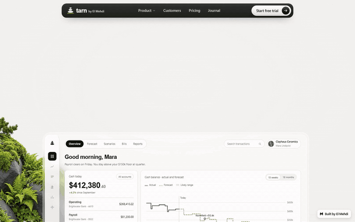
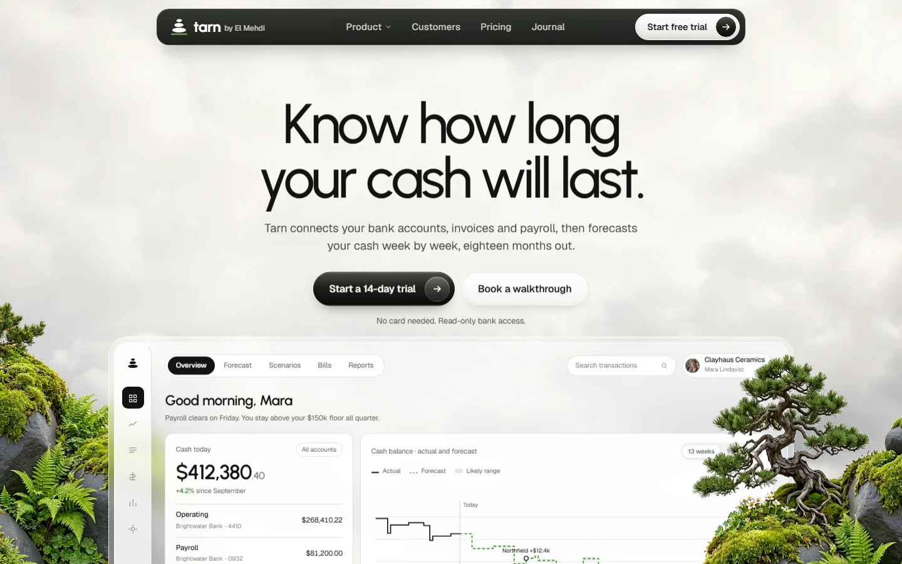
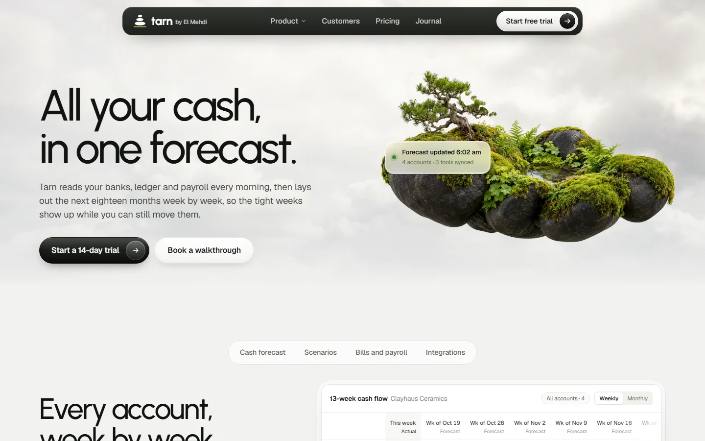
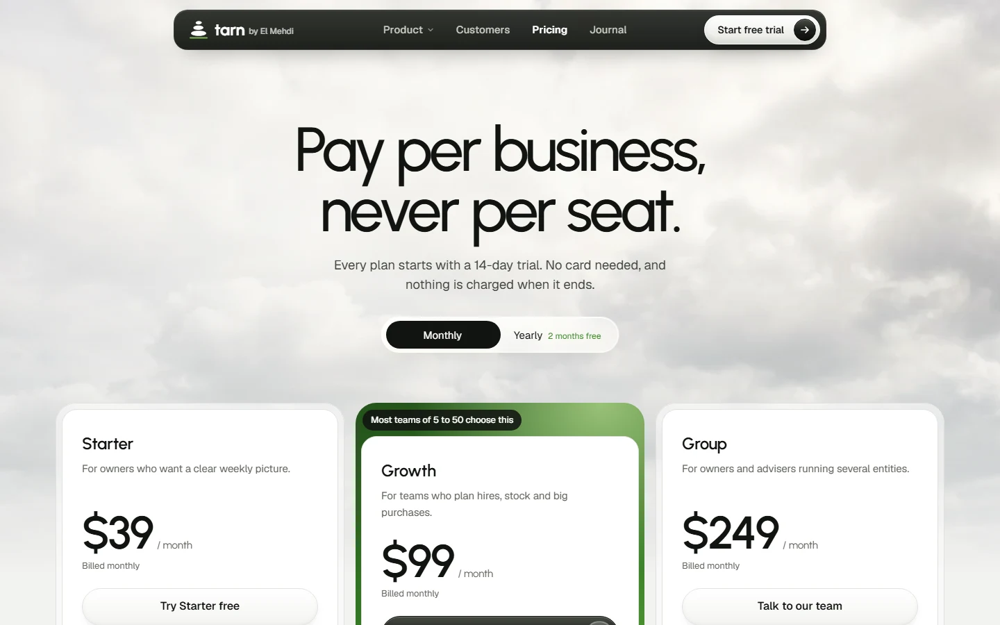
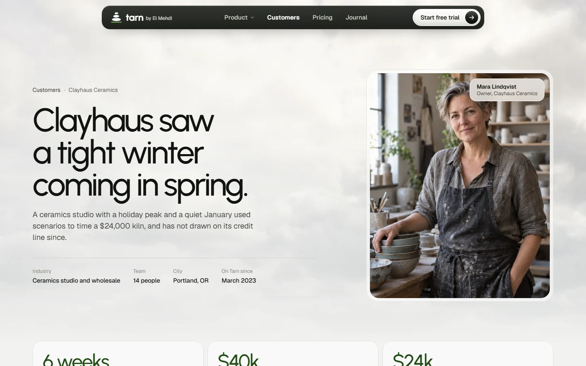
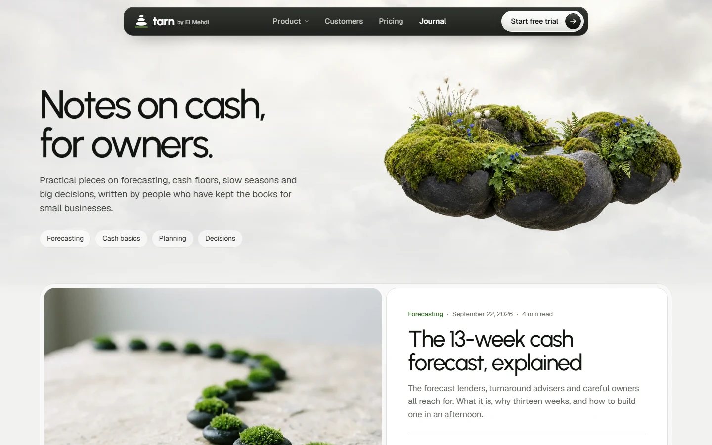
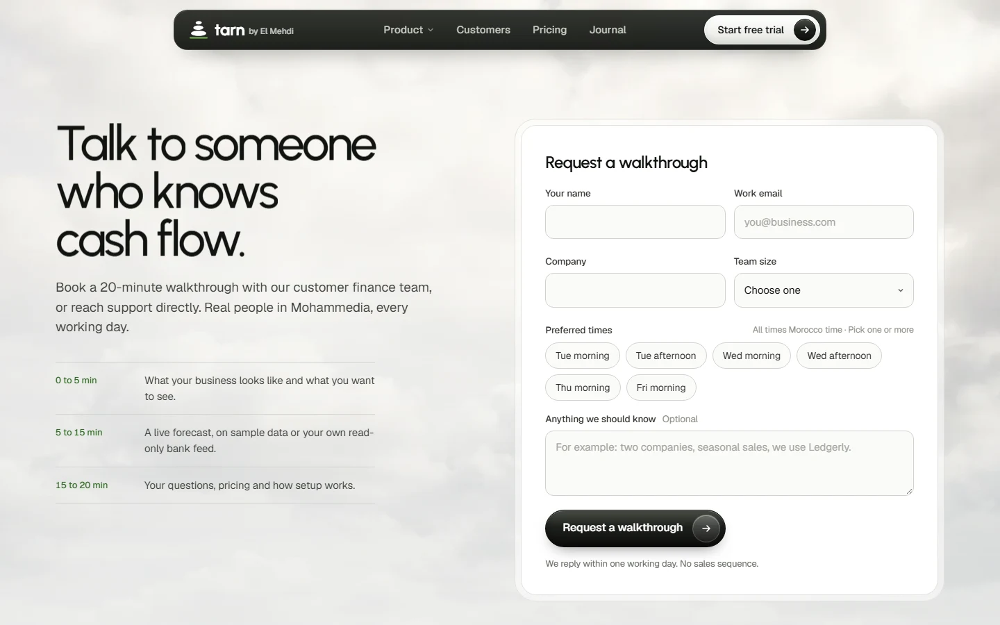
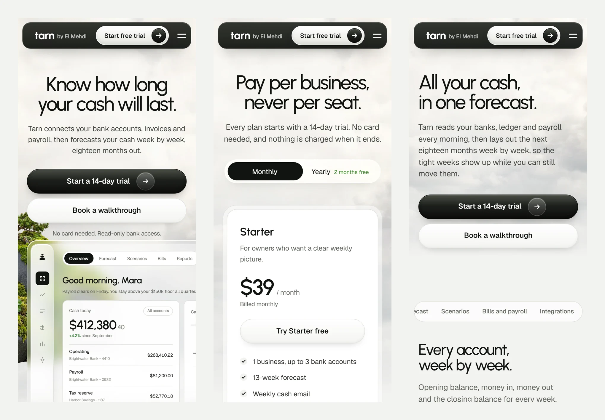

<div align="center">

# Tarn by El Mehdi

### A cash-flow forecasting product website: live dashboard mock-up, scenarios, pricing, customer stories and a journal

18 pages with a working scenario demo, a product tour with charts, a monthly / yearly pricing switch, a free-trial form<br>
and a walkthrough booking form. Responsive, self-hosted fonts and images, deployed on Cloudflare.

[](https://tarn-by.elmehdisekrare.workers.dev/)


<br>

<a href="https://tarn-by.elmehdisekrare.workers.dev/"></a>

</div>

<br>

## ✦ Highlights

- **Dashboard hero**: a forecast dashboard mock-up ("Good morning, Mara") with cash today, account balances and an actual-vs-forecast chart, floating between moss-covered rocks
- **Scenario demo**: switch scenarios on ("Hire a production lead", "Northfield Hotels pays late") and watch the cash runway move, before anything changes in the books
- **Product tour**: chapter tabs for cash forecast, scenarios, bills and payroll and integrations, a 13-week cash-flow table with a weekly / monthly switch, and charts with tooltips
- **Pricing**: a monthly / yearly switch (two months free), three plans, a plan comparison, FAQ, and a 14-day trial form with a custom select and inline validation
- **Customer stories and journal**: four stories with a category filter and full story pages, four journal articles
- **Contact**: a walkthrough request form (name, work email, company, preferred time slots) with inline errors and a confirmation card, plus an "open now" line worked out on Morocco time
- **Motion details**: page transitions, rolling-letter nav links, a product dropdown with a featured story, drifting rocks and a floating cairn on the 404 page, with `prefers-reduced-motion` support
- **Static hosting**: no server code; Cloudflare serves `site/` with `/x` → `/x/` redirects, the custom 404 page and headers from `site/_headers`

<br>

## ✦ Screenshots

<table>
  <tr>
    <td width="50%"><p align="center"><b>Home</b>: the forecast dashboard</p></td>
    <td width="50%"><p align="center"><b>Product</b>: all your cash, in one forecast</p></td>
  </tr>
  <tr>
    <td width="50%"><p align="center"><b>Pricing</b>: monthly / yearly, three plans</p></td>
    <td width="50%"><p align="center"><b>Customer story</b>: Clayhaus Ceramics</p></td>
  </tr>
  <tr>
    <td width="50%"><p align="center"><b>Journal</b>: notes on cash</p></td>
    <td width="50%"><p align="center"><b>Contact</b>: request a walkthrough</p></td>
  </tr>
</table>

### On phone

<p align="center"></p>

<br>

## ✦ Pages

| Page | What's on it |
|---|---|
| `/` | Dashboard hero, key numbers, warnings, scenario demo, integrations, customer quotes, pricing teaser, FAQ |
| `/product/` | Chapter tour: cash forecast, scenarios, bills and payroll, integrations |
| `/pricing/` | Monthly / yearly plans, comparison, FAQ, 14-day trial form |
| `/customers/` + 4 stories | Filterable customer stories and full story pages |
| `/journal/` + 4 articles | Articles on forecasting, cash floors, hiring and slow seasons |
| `/about/` · `/contact/` · `/security/` | Company story, walkthrough form and office, security practices |
| `/privacy/` · `/terms/` | Legal pages |
| `/404.html` | Custom "this trail ends here" page |

<br>

## ✦ Stack

- **Site**: Astro static build: HTML, CSS and JavaScript (ES modules), with GSAP for motion
- **Fonts**: Urbanist and Geist, self-hosted
- **Hosting**: Cloudflare Workers static assets (`wrangler.toml`, `site/_headers`); every push to `main` deploys
- **Local preview**: `scripts/serve.mjs` (Node, no dependencies)

<br>

## ✦ Getting started

```bash
git clone https://github.com/elmehdi-sekrare/tarn-by-elmehdi.git
cd tarn-by-elmehdi
npm start            # http://localhost:5335
```

Node 18+. There is nothing to install: `scripts/serve.mjs` serves `site/` the way Cloudflare does (`/x` → `/x/`, the 404 page).

<br>

## ✦ Deploy

Cloudflare dashboard → **Workers & Pages → Create → Import a repository** → pick this repo → keep the defaults
(deploy command `npx wrangler deploy`). `wrangler.toml` serves `site/` as static assets (no Worker script) and `site/_headers`
sets the headers (noindex, nosniff, long caching for the hashed `/_astro/` files). All forms run in the browser: nothing is sent.

<br>

## ✦ Project structure

```
site/                18 pages + 404, Astro bundles, fonts, images, _headers
scripts/serve.mjs    local preview
docs/                README screenshots and preview
wrangler.toml        Cloudflare settings
```

<br>

## ✦ Contact

[](https://www.linkedin.com/in/el-mehdi-sekrare-77000629b)
[](mailto:elmehdisekrare@gmail.com)
[](https://github.com/elmehdi-sekrare)

---

<sub>Based on the Tarn template by Visuvate.</sub>
